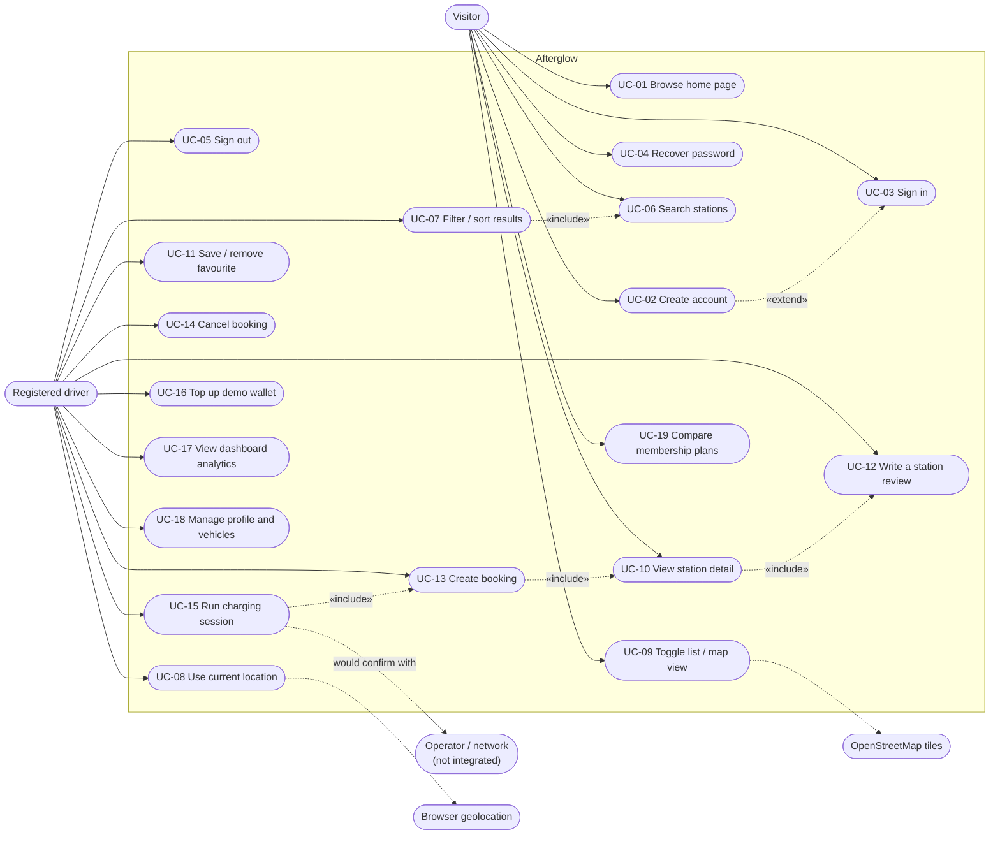

# 02 — Use Case Diagram and Catalogue

## Actors

* **Visitor** — not signed in.
* **Registered driver** — signed in (inherits every Visitor use case).
* **Operator / network** — external charging network. *Not integrated*; shown as a
  secondary actor only for the flows that would call it in a real deployment.
* **Geolocation service / OpenStreetMap tile server** — supporting systems used by
  "Near me" and the map view.

## Diagram

## Use case catalogue

Route names refer to the frontend router in `frontend/src/App.tsx`; handler names
refer to `backend/src/routes/*.js`.

### UC-02 Create account

| | |
| --- | --- |
| **Primary actor** | Visitor |
| **Route / handler** | `/signup` → `POST /api/v1/auth/signup` (`routes/auth.js`) |
| **Preconditions** | None |
| **Main flow** | 1. Visitor opens *Create your account*. 2. Fills name, email, phone, password, confirmation, accepts terms. 3. Client-side zod schema validates the fields. 4. `authService.signup` posts the payload. 5. Server validates, hashes the password with scrypt, inserts `users`, creates `wallets` and an `auth_sessions` row in one transaction. 6. Client stores the session token and navigates to `/dashboard`. |
| **Alternative flows** | 3a. Invalid field → message rendered beside the field and announced (`role="alert"`, `aria-invalid`, `aria-describedby`). 5a. Duplicate email → `409 CONFLICT`; 5b. weak password or mismatched confirmation → `400 VALIDATION_ERROR`. |
| **Postconditions** | User, wallet (0 balance) and session exist; the user is signed in. |

### UC-03 Sign in

| | |
| --- | --- |
| **Primary actor** | Visitor |
| **Route / handler** | `/login` → `POST /api/v1/auth/login` |
| **Preconditions** | An account exists |
| **Main flow** | 1. Visitor enters email + password (or uses the *Use the demo account* hint, which fills the seeded credentials). 2. Server verifies the scrypt hash. 3. A session token is issued and stored; the app navigates to `/dashboard` or back to the originally requested page. |
| **Alternative flows** | 2a. Wrong credentials → `401 UNAUTHORIZED` ("Invalid email or password.") shown in an alert region; no token stored. |
| **Postconditions** | A valid session exists; protected routes render. |
| **Evidence** | `frontend/src/pages/auth/LoginPage.test.tsx` (5 cases), `backend/test/auth.test.js` |

### UC-04 Recover password

| | |
| --- | --- |
| **Primary actor** | Visitor |
| **Route / handler** | `/forgot-password` → `POST /auth/forgot-password`; `/reset-password` → `POST /auth/reset-password` |
| **Main flow** | 1. Visitor submits an email. 2. Server always answers with the same message (no account enumeration) and, when the account exists, creates a single-use token hashed into `password_resets` with a 30-minute expiry. 3. In this build the link is returned in the response and displayed, because email delivery (FE-5) is not configured. 4. Submitting the token with a new password consumes it and revokes existing sessions. |
| **Alternative flows** | 4a. Unknown, used or expired token → `400 VALIDATION_ERROR` ("This reset link is invalid or has expired."). |

### UC-05 Sign out

| | |
| --- | --- |
| **Primary actor** | Registered driver |
| **Route / handler** | Header menu → `POST /auth/logout` (`authService.logout`) |
| **Main flow** | 1. Driver selects *Sign out*. 2. The server marks the session revoked. 3. The client clears the stored token **even if the request fails** and navigates home. |

### UC-06 Search stations · UC-07 Filter / sort · UC-08 Near me · UC-09 List / map

| | |
| --- | --- |
| **Primary actor** | Visitor / driver |
| **Route / handler** | `/search` → `GET /stations`, `GET /stations/meta/filters`, `GET /stations/nearby` |
| **Main flow** | 1. Query entered in the search bar (or `?q=` from the home page). 2. Filter chips/price slider/availability toggle build a `SearchFilters` object. 3. The query is sent to the API with page/limit/sort. 4. Results render as cards or as Leaflet/OSM markers; the count is announced through `role="status"`. 5. Selecting a card highlights its marker and vice versa; the URL records `?view=map`. |
| **Alternative flows** | 3a. API unreachable → bundled sample data with a *Demo mode* banner. 3b. Empty result → "No stations found" with a *Clear filters* action. |
| **Evidence** | `backend/test/stations.test.js`, `frontend/src/utils/helpers.test.ts` (filter logic) |

### UC-10 View station detail

| | |
| --- | --- |
| **Primary actor** | Visitor / driver |
| **Route / handler** | `/station/:id` → `GET /stations/:id`, `GET /stations/:id/reviews` |
| **Main flow** | 1. Detail page loads connectors (type, power, count), pricing, amenities, operator, opening hours, coordinates on the map and the review list with the computed average. 2. Data-freshness labels mark the record as sample data. 3. *Book a charging session* continues to UC-13. |
| **Alternative flows** | Unknown id → not-found state. |

### UC-11 Save / remove favourite

| | |
| --- | --- |
| **Primary actor** | Registered driver |
| **Route / handler** | Station page *Save* / search-card heart → `POST` or `DELETE /stations/:id/favorite`, list at `GET /users/favorites` |
| **Main flow** | 1. Driver activates the control. 2. The favourite row is inserted or deleted idempotently. 3. The control reflects the new state and a live region confirms it. 4. Saved stations appear on `/profile` and the dashboard. |
| **Alternative flows** | Visitor → the heart is a link to `/login` instead of a dead button. |

### UC-12 Write a review

| | |
| --- | --- |
| **Primary actor** | Registered driver |
| **Route / handler** | Station page review form → `POST /stations/:id/reviews` |
| **Main flow** | 1. Driver picks 1–5 stars and enters a title and comment. 2. Server validates and inserts one review per user per station (`UNIQUE (station_id, user_id)`). 3. The average rating and count are recomputed from stored reviews and shown. |
| **Alternative flows** | Re-submission by the same user updates the existing row (one review per user per station); unauthenticated submission → `401 UNAUTHORIZED`; invalid rating/title/comment → `400 VALIDATION_ERROR`. |

### UC-13 Create booking

| | |
| --- | --- |
| **Primary actor** | Registered driver |
| **Route / handler** | `/bookings?stationId=…` → `POST /bookings` |
| **Main flow** | See the activity diagram in [05-activity-diagrams.md](05-activity-diagrams.md). Summary: pick connector, date, start time and duration (15–480 min) → estimated cost preview → server verifies the connector exists, the time window is in the future, and no overlapping booking exists for that station+connector → row inserted with `simulated = 1`. |
| **Alternative flows** | Overlap → `409 CONFLICT`; past start, duration outside 15–480 min, or a connector the station does not offer → `400 VALIDATION_ERROR`; station out of service → `409 CONFLICT`. |
| **Postconditions** | A `confirmed`, simulated booking exists for the signed-in user only. |
| **Evidence** | `backend/test/bookings.test.js` — conflict, past-time, ownership and cancellation cases |

### UC-14 Cancel booking

| | |
| --- | --- |
| **Primary actor** | Registered driver |
| **Route / handler** | Booking card → `POST /bookings/:id/cancel` |
| **Main flow** | 1. Driver cancels a confirmed booking. 2. Server checks ownership and that the transition is legal, then sets `status = 'cancelled'`. 3. The list filter *Cancelled* shows it; cancelled bookings are excluded from dashboard counts. |

### UC-15 Run charging session `[DEMO]`

| | |
| --- | --- |
| **Primary actor** | Registered driver |
| **Route / handler** | Booking card → `POST /bookings/:id/start`, `POST /bookings/:id/stop`, `GET /bookings/history` |
| **Main flow** | 1. *Start charging* requires a confirmed booking and sets it `active`, creating a `charging_sessions` row. 2. *Stop charging* computes energy and cost, debits `wallets.balance_minor` and appends a `wallet_transactions` row inside one transaction, marks the booking `completed` and stores the session. |
| **Alternative flows** | Insufficient balance → `409 CONFLICT` ("Insufficient wallet balance for this operation."), the session stays open and the booking stays `active`. Starting a booking that is not `confirmed` → `409 CONFLICT`. Accessing another user's booking → `403 FORBIDDEN`. |
| **Postconditions** | Wallet ledger and session history agree; the UI states "no real hardware is involved". |

### UC-16 Top up demo wallet `[DEMO]`

| | |
| --- | --- |
| **Primary actor** | Registered driver |
| **Route / handler** | `/wallet` → `POST /users/wallet/topup`, `GET /users/wallet`, `GET /users/wallet/transactions` |
| **Main flow** | 1. Driver chooses a preset amount. 2. Server validates bounds, increments the balance and appends a `topup` ledger entry with the resulting balance. 3. The page explains that no real money moves. |

### UC-17 View dashboard analytics

| | |
| --- | --- |
| **Primary actor** | Registered driver |
| **Route / handler** | `/dashboard` → `GET /users/analytics` |
| **Main flow** | Totals (sessions, energy, spend, bookings) and monthly usage are computed by SQL from the user's own bookings and sessions; empty states explain that nothing is invented when there is no data. |

### UC-18 Manage profile and vehicles

| | |
| --- | --- |
| **Primary actor** | Registered driver |
| **Route / handler** | `/profile` → `GET/PUT /users/profile`, `GET/POST/PUT/DELETE /users/vehicles` |
| **Main flow** | Update name/phone/units/notifications, add or remove vehicles with make, model, year, battery capacity, connector types and range. Every write is scoped to the owner. |

### UC-19 Compare membership plans

| | |
| --- | --- |
| **Primary actor** | Visitor / driver |
| **Route / handler** | `/membership` (presentation only — no billing endpoint exists) |
| **Main flow** | Free/Premium/Elite features and prices are compared. Only Free is available; paid tiers are marked *Planned* and cannot be purchased, because payment integration is FE-4. |
